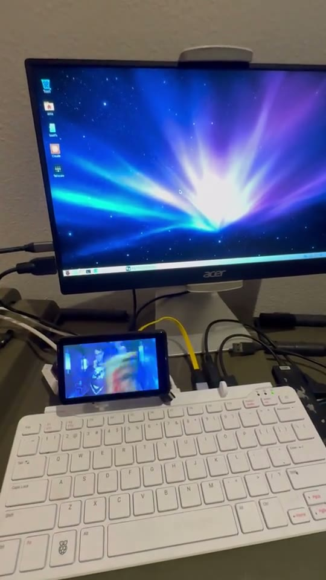
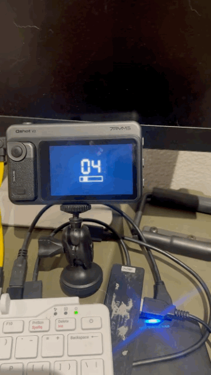

# Raspberry Pi 500: setup and observed results

Recorded 2026-10-27. The selected use is an extra LUODIER/EBPSI desktop alongside
HDMI. This page records a working demonstration and its remaining limits; it is
not an accepted unattended-install recipe.

## Connections and software

| Item | Demonstrated configuration |
|---|---|
| Host | Raspberry Pi 500 Rev 1.0, Debian 13 ARM64, labwc 0.20.2 |
| Main display | Existing HDMI desktop, 1920×1080 |
| Extra display | LUODIER/EBPSI in Android/Miracast mode, connected by Wi-Fi Direct |
| Virtual output | 1280×720 at a 30 Hz target, scale 2, placed right of HDMI |
| Recovery and internet | Ethernet retained for SSH and the default internet route |
| Application | Experimental PanelBridge `0.1.0~dev4` |

The screen may need its USB cable for power; that does not make its PanelBridge
video path wired. Leave Ethernet attached during casting. The Pi's USB-C power
input is not the USB 3 Type-A host port used in the separate Qshot test.

The installer now accepts Pi 500 and preserves unrelated residual package
configuration during its baseline checks. All 60 installed payload entries
matched their recorded hashes and modes. This verifies the inspected deployment,
not arbitrary fresh machines or a public binary release. Advanced frequency
controls remain restricted to their separately checked Pi 5 path.

## Using the demonstrated setup

On the already prepared Pi, power the LUODIER/EBPSI and select its Android/Miracast
mode. Open PanelBridge from the desktop, select the receiver and connect. Move
a browser window right from the HDMI desktop onto the virtual output. The owner
played the [requested YouTube video](https://www.youtube.com/watch?v=kdemFfbS5H0)
and confirmed that HDMI still responded to mouse and keyboard.

The tested setup uses manual connection; automatic casting is disabled. Use
PanelBridge's Disconnect control to stop a session. One stop restored home Wi-Fi
and a following manual start connected again. Later timeout evidence means this
is not yet a guaranteed repeatable start/stop procedure. Local startup-entry
changes also need reconciliation with the installer's configuration-integrity
checks before an upgrade or uninstall; do not bypass those checks.

[Silent recording](media/pi500-luodier-extended-desktop.mp4) ·
[Media captions and provenance](media/README.md)

## Observed limits and next acceptance

- The first trial froze the HDMI desktop and SSH stopped accepting connections;
  the owner restarted the Pi. Logs did not establish the cause.
- A later 60-second health sample showed 41.35–43 °C, no reported throttling,
  25.5–35.3% aggregate CPU usage and approximately 29–31 encoded buffers/second.
  Encoded buffer rate is not measured receiver frame rate.
- At closeout, the session reported `g-io-error-quark: Timeout was reached (24)`.
  A stop request was accepted, but the error persisted and bounded NetworkManager
  reads timed out. No native video sender or Qshot runner remained. Ethernet,
  SSH and the existing OLED service were still available. Clean final network
  restoration was not established.
- The recordings show physical output during their capture windows; they do not
  prove current service state or resolve the timeout.

Next acceptance is diagnosis of the freeze and timeout, repeated manual
start/stop/reconnect, then reboot/power-cycle recovery, longer observed playback
and clean upgrade/uninstall. Audio and automatic casting remain unqualified.
The existing desktop, applications and OLED remain part of the preservation
requirements; no new OLED rollout or overclock trial belongs to this checkpoint.

## Qshot: a separate wired result

The 7RYMS Qshot V2 non-Pro connected to a Pi USB 3 Type-A port through a data
cable/adapter, terminating at the screen's USB-C socket labelled UVC. It enumerated
as `05ac:12ad` and answered HCCAST identification as `HC15B100`, version
`2511261024`. A startup-preamble parsing bug was fixed before playback.

A 300-frame, 1280×720 monochrome sequence completed in 29.902 seconds at a 10 fps
target. The owner confirmed correct motion and USB closed cleanly. A preceding
five-second 30 fps transfer was not visually observed and is not a Pi 500
physical 30 fps claim. No persistent Qshot desktop service was installed.

[Silent original-length recording](media/pi500-qshot-wired.mp4). The short GIF and
recording show only portions of the test, not its full duration. Audio, extended
desktop integration, reconnect and sustained Qshot use on Pi 500 remain open.

## TTQ TF39: connection test remains inconclusive

The first connection used an HDMI-to-USB capture dongle and produced a powered
but dark screen. That dongle does not supply USB-C DisplayPort video. The owner
then tried TTQ's Video port in the same USB host cable/adapter configuration as
Qshot. Passive enumeration showed no TTQ or video-class USB interface; no TTQ
commands, resets or configuration writes followed.

TTQ's documented input is DisplayPort Alternate Mode. The existing Pi HDMI path
would need a correctly directed, powered active HDMI-to-USB-C DisplayPort display
converter for that input. That pairing has not been tested. The successful
Qshot HCCAST path and the LUODIER recording do not establish TTQ support.

## Building and release boundary

The root Python wheel packages the legacy driver only. PanelBridge also requires
a compiled Linux native worker and distro GUI/network/media dependencies. Source
entry points are the [worker build recipe](../apps/panelbridge/native/wfd/build-worker.sh),
[source bundle](../apps/panelbridge/interfaces/SOURCE_BUNDLE.md),
[Debian package builder](../apps/panelbridge/packaging_tools/build_package.py) and
[installer builder](../apps/panelbridge/packaging_tools/build_installer.py).

The retained development worker contains private build paths in runtime/debug
records. A distributable binary must be rebuilt and inspected with its matching
source and dependency notices. This publication contains source, documentation and
selected demonstration media; it does not create a tagged installer release.
